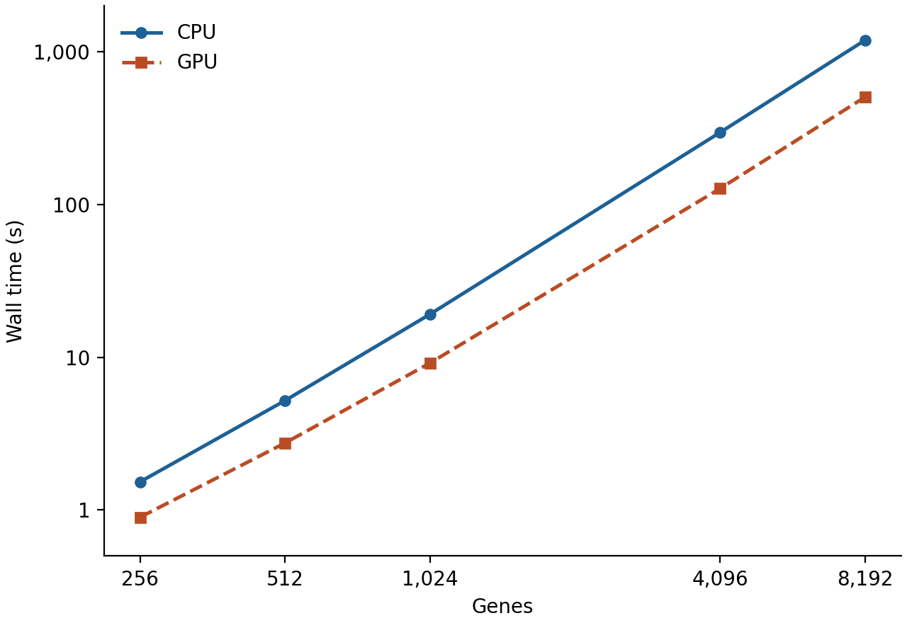

# mimiq-cuda

`mimiq-cuda` is a standalone Python package containing the optimized
histogram-native pairwise mutual-information implementation developed from
Mimiq. It provides:

- a multithreaded C++/OpenMP CPU backend;
- a CUDA backend tuned for large feature-by-cell count matrices;
- normal, negative-binomial (NB2), and zero-inflated NB2 marginals;
- the same adaptive partition and chi-square calculation on both backends.

The package imports as `mimiq_cuda`, so it can coexist with the original
`mimiq` distribution.

Its CUDA implementation is self-contained in `cpp/mi_cuda_backend.cu`. The
translation unit contains only MI code and uses no PIDC compile guards or
symbols.

## Install

Building from source requires a C++20 compiler, CMake 3.24+, Eigen, Boost,
OpenMP, and the CUDA toolkit (including `nvcc`). The installed extension
statically links the CUDA runtime; a compatible NVIDIA driver is still
required to execute the GPU functions.

```bash
python -m pip install .
```

To build a wheel:

```bash
python -m pip install build
python -m build --wheel
python -m pip install dist/mimiq_cuda-*.whl
```

By default the wheel embeds native code for several CUDA generations and PTX
for the newest configured generation. Override the list when building for a
specific fleet:

```bash
CMAKE_ARGS="-DMIMIQ_CUDA_ARCHITECTURES=80-real;90-real;120" \
  python -m build --wheel
```

`MIMIQ_PORTABLE_BUILD=ON` is the default and avoids `-march=native`. Set it to
`OFF` only for a machine-local CPU build.

## Use

```python
import numpy as np
import mimiq_cuda

rng = np.random.default_rng(42)
cells, genes = 50_000, 1_000
concentration = rng.uniform(2.0, 20.0, genes)
mean = rng.uniform(0.5, 40.0, genes)
p = concentration / (concentration + mean)
counts = rng.negative_binomial(concentration, p, size=(cells, genes)).astype(
    np.int32
)

mi_gpu, chi2_gpu = mimiq_cuda.mi_negative_binomial_gpu(
    counts, mean, concentration, min_pop=25, max_bins=64
)
mi_cpu, chi2_cpu = mimiq_cuda.mi_negative_binomial_cpu(
    counts, mean, concentration, min_pop=25, max_bins=64
)
```

Matrices contain the pair values in the strict upper triangle. Use
`matrix + matrix.T` when a symmetric result is convenient. The GPU backend
supports `1 <= max_bins <= 64`; the CPU backend additionally accepts
`max_bins=0` for unbounded distinct-count ranks. Use the same nonzero
`max_bins` to compare backends exactly.

The normal and zero-inflated variants are
`mi_normal_{cpu,gpu}` and `mi_negative_binomial_zi_{cpu,gpu}`. Compatibility
aliases ending in `_hist` and `_hist_gpu` are also exported.

## Performance

On one million cells, MIMIQ with normal marginals ran about twice as fast on the GPU as on 12 CPU cores.



## Test

```bash
python -m pytest
```

GPU tests skip cleanly when no CUDA device is available.

## Platform scope

The initial supported binary target is Linux x86-64 with an NVIDIA GPU.
CUDA is not available on macOS. Python bindings use pybind11 and therefore
produce one wheel per CPython version rather than a stable-ABI wheel.
